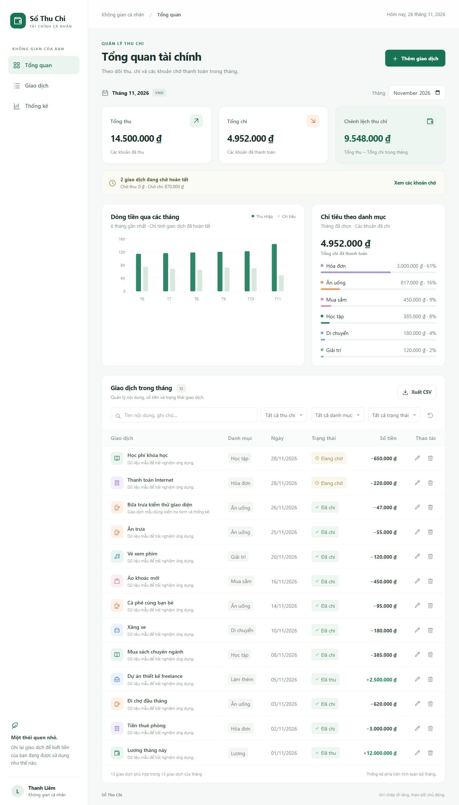
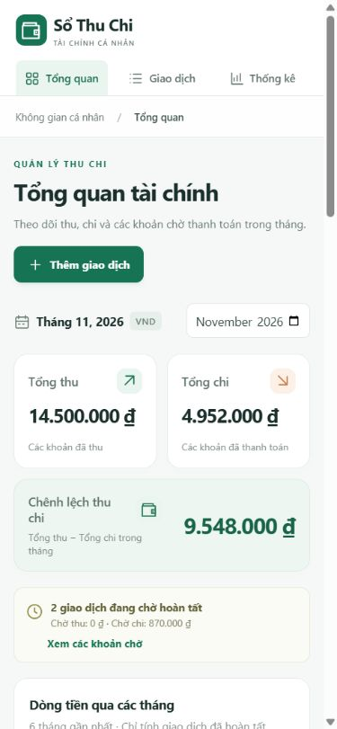
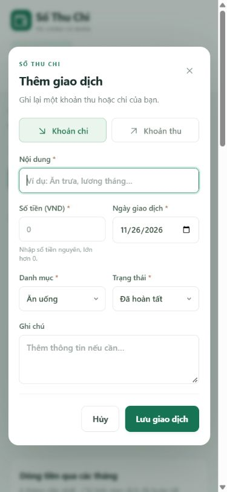
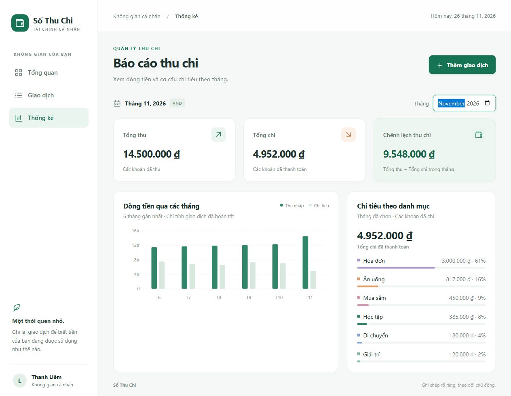

# Giao diện Sổ Thu Chi

Giao diện được chụp trực tiếp từ ứng dụng đang chạy với dữ liệu mẫu. Ảnh desktop có thêm một giao dịch kiểm thử 47.000 đồng, vì vậy tổng chi là 4.952.000 đồng; database mới khởi tạo chỉ có dữ liệu seed, tổng chi là 4.905.000 đồng trong tháng khởi tạo.

## Phong cách và bố cục

- Màu chính xanh lá #167454, nền sáng #f5f8f7, chữ #1b302c; các loại giao dịch có biểu tượng và nhãn bằng chữ.
- Sidebar điều hướng ba màn hình trên desktop, chuyển thành thanh điều hướng phía trên trên màn hình nhỏ.
- Tổng quan: thẻ tổng thu, tổng chi, chênh lệch; nhắc khoản đang chờ; biểu đồ và danh sách giao dịch.
- Giao dịch: form thêm/sửa, tìm kiếm và lọc; trạng thái bấm được; xác nhận trước khi xóa.
- Thống kê: biểu đồ cột so sánh thu/chi 6 tháng và các thanh tỷ trọng chi theo danh mục.
- Form có nhãn, đánh dấu bắt buộc, thông báo lỗi; hỗ trợ bàn phím và focus; hộp thoại dùng dialog gốc của trình duyệt.
- Màn hình điện thoại được kiểm tra với viewport 390 × 844. Bảng giao dịch cuộn ngang trong vùng riêng, không làm cả trang tràn ngang.

## Ảnh minh chứng

### Tổng quan desktop



### Tổng quan điện thoại



### Form trên điện thoại



### Thống kê desktop



## Kết quả kiểm tra

- Build thành công, 0 lỗi và 0 cảnh báo.
- Kiểm thử tích hợp qua 24 trường hợp: database trống, danh mục, chống CSRF, dữ liệu sai, thêm/sửa/xóa, trạng thái, thống kê, bộ lọc, xung đột phiên bản, giữ dữ liệu qua lần khởi động lại và bản ghi không tồn tại.
- Qua giao diện đã xác nhận: thêm 45.000 đồng → tổng chi tăng; sửa thành khoản chờ 47.000 đồng → tổng chi giảm về trước đó; hoàn tất khoản này → tổng chi tăng đúng 47.000 đồng.
- Hộp xác nhận xóa mở đúng tên và nút Giữ lại không xóa bản ghi. Luồng xóa thật được kiểm tra bằng API trên database thử nghiệm riêng.
- Bộ lọc không có kết quả hiển thị trạng thái rỗng; tháng chưa có dữ liệu hiển thị thống kê 0 và lời giải thích.
- Xuất CSV nhận đủ tiêu đề tiếng Việt, 13 giao dịch sau thử giao diện và số tiền đã sửa.
- Không ghi nhận lỗi hoặc cảnh báo JavaScript trong trình duyệt ở phiên kiểm tra cuối.

Để chạy lại kiểm thử tích hợp trên PowerShell 7, sau khi build:

```powershell
dotnet build
pwsh -File tests/Integration.ps1
```

Script dùng database riêng trong artifacts, cổng 5199; không thay đổi sổ đang dùng ở cổng 5188. Database thử và log không nằm trong gói mã nguồn nộp bài.
