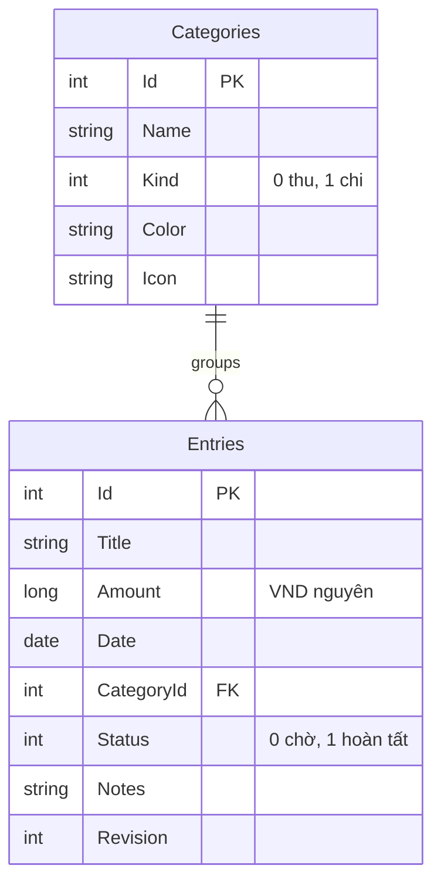

# Sổ Thu Chi — ứng dụng quản lý thu chi cá nhân

Bài thực hành frontend và backend của Nguyễn Thanh Liêm. Ứng dụng chạy cục bộ, gồm giao diện HTML/CSS/JavaScript, API ASP.NET Core .NET 10 và database SQLite thật. Giao dịch được lưu sau khi đóng trình duyệt hoặc khởi động lại ứng dụng.

## Đối chiếu yêu cầu 4 điểm

| Tiêu chí | Kết quả trong dự án |
|---|---|
| Giao diện / thiết kế — 2 điểm | Ba màn hình Tổng quan, Giao dịch, Thống kê; giao diện thích ứng desktop và điện thoại; form thêm/sửa; xác nhận xóa; biểu đồ SVG. |
| Database — 1 điểm | Bảng Categories và Entries liên kết khóa ngoại; migration EF Core; Database/schema.sql và Database/ERD.svg. |
| Hệ thống hoàn chỉnh — 1 điểm | Giao diện gọi API để thêm, sửa, xóa, cập nhật trạng thái và thống kê; kiểm tra dữ liệu ở cả frontend lẫn backend. |

## Chạy ứng dụng

Cần .NET 10 SDK. Không cần cài SQL Server, Node.js hoặc thư viện JavaScript bên ngoài.

Mở Terminal tại thư mục có SoThuChi.csproj:

```powershell
dotnet restore
dotnet run
```

Sau khi Terminal thông báo `Now listening`, mở **http://localhost:5188**. Nhấn Ctrl+C để dừng.

Trên Windows cũng có thể nhấp đúp `CHAY_UNG_DUNG.cmd`. Xem thư mục Design để xem các ảnh giao diện đã chụp và kết quả kiểm thử.

Ứng dụng tự áp dụng migration và tạo `App_Data/finance.db` ở lần chạy đầu. Database tạo sẵn 10 danh mục; khi SeedDemo = true còn có các giao dịch mẫu trong tháng khởi tạo và 5 tháng trước. Các giao dịch mẫu có ghi chú nhận diện. Dữ liệu mẫu chỉ tạo một lần; xóa hoặc sửa chúng không làm chúng tự xuất hiện lại sau khi khởi động.

Muốn khởi tạo sổ trống: đặt `SeedDemo` thành `false` trong appsettings.json **trước lần chạy đầu trên database mới**. Thay đổi tùy chọn này không xóa các giao dịch đã tồn tại.

## Chức năng

- Thêm giao dịch: chọn Thu/Chi, nhập nội dung, số tiền nguyên VND, ngày, danh mục và trạng thái.
- Sửa: chọn biểu tượng bút tại dòng giao dịch; có thể đổi cả loại và danh mục.
- Xóa: chọn biểu tượng thùng rác rồi xác nhận. Hủy sẽ giữ lại dữ liệu.
- Cập nhật trạng thái: bấm nhãn Đang chờ/Đã thu/Đã chi ngay trên dòng; thống kê cập nhật theo kết quả lưu.
- Tìm kiếm nội dung, ghi chú; lọc tháng, loại, danh mục và trạng thái.
- Thống kê tổng thu, tổng chi, chênh lệch tháng; khoản chờ thu/chờ chi; biểu đồ 6 tháng; chi theo danh mục.
- Xuất CSV cho danh sách đang lọc, có BOM UTF-8 để Excel nhận tiếng Việt.

### Quy tắc thống kê

Tổng thu/chi và biểu đồ chỉ tính giao dịch **Đã hoàn tất**. Khoản đang chờ hiển thị riêng và không làm tăng/giảm chênh lệch đã thực hiện. Chênh lệch là thu trừ chi **trong tháng**, không phải số dư tài khoản tích lũy. Các bộ lọc tìm kiếm/loại/danh mục/trạng thái chỉ lọc bảng giao dịch; thống kê luôn tính toàn bộ tháng đã chọn. Biểu đồ xu hướng kết thúc ở tháng đang chọn.

## Cấu trúc

```text
SoThuChi.csproj
Program.cs                 Cấu hình ứng dụng, database và token chống CSRF
Controllers/               API giao dịch, danh mục và thống kê
Models/                    Entity, dữ liệu nhận từ form và dữ liệu trả về
Data/                      DbContext và dữ liệu mẫu
Migrations/                Lịch sử cấu trúc database
Database/schema.sql        SQL tạo cấu trúc SQLite
Database/ERD.svg            Sơ đồ quan hệ 1–N
wwwroot/index.html         Khung ba màn hình và hộp thoại
wwwroot/styles.css         Thiết kế responsive
wwwroot/app.js             Gọi API, dựng bảng, biểu đồ, form
App_Data/finance.db        Database được tạo khi chạy, không đưa lên GitHub
tests/                     Kiểm thử tích hợp với database riêng
```

## Thiết kế dữ liệu



Không lặp cột loại trong Entries: loại thu/chi suy ra từ danh mục. Amount lưu số nguyên để tránh sai số số thực. Revision là dấu phiên bản: nếu hai cửa sổ cùng sửa, yêu cầu mang phiên bản cũ nhận HTTP 409 thay vì ghi đè dữ liệu mới.

## API

| Phương thức | Đường dẫn | Vai trò |
|---|---|---|
| GET | /api/session | Lấy ngày hiện tại và token chống CSRF |
| GET | /api/categories | Các danh mục thu/chi |
| GET | /api/entries?month=yyyy-MM | Danh sách giao dịch; thêm kind, categoryId, status, search nếu cần |
| GET | /api/statistics?month=yyyy-MM | Thống kê tháng và 6 tháng gần nhất |
| POST | /api/entries | Tạo giao dịch |
| PUT | /api/entries/{id} | Sửa giao dịch, gửi Revision hiện tại |
| PATCH | /api/entries/{id}/status | Cập nhật Status và Revision |
| DELETE | /api/entries/{id}?revision=n | Xóa đúng phiên bản hiện tại |

Các yêu cầu thay đổi dữ liệu cần cookie chống CSRF từ /api/session và header X-CSRF-TOKEN. Giao diện tự thực hiện việc này. Không cho phép CORS từ website khác; dữ liệu nhập được escape khi hiển thị. Nội dung tối đa 120 ký tự, ghi chú tối đa 500; số tiền từ 1 đến 999.999.999.999 đồng; ngày từ 1900–2100; danh mục phải tồn tại.

## Giới hạn phạm vi

Đây là sổ cá nhân chạy trên máy, chưa có đăng nhập hoặc phân quyền nhiều người dùng. Dùng dữ liệu giả khi trình bày bài. Nếu triển khai công khai cần bổ sung đăng nhập, tách dữ liệu theo người dùng, HTTPS và cơ chế sao lưu. Không dùng file database cá nhân làm dữ liệu nộp GitHub.

## Tài liệu kỹ thuật

- [Microsoft Learn — Minimal API và SQLite với EF Core](https://learn.microsoft.com/en-us/training/modules/build-web-api-minimal-database/)
- [Microsoft Learn — Chống CSRF trong ASP.NET Core](https://learn.microsoft.com/aspnet/core/security/anti-request-forgery?view=aspnetcore-10.0)
